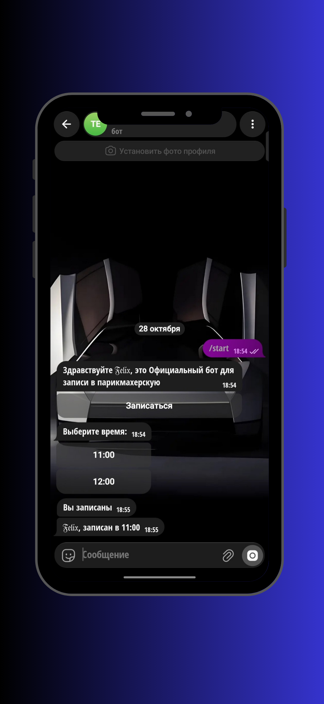

# ✂️ Telegram-бот для записи в парикмахерскую

 бот для быстрой и удобной записи клиентов. Никаких сложных баз данных и перегрузок — только мгновенное бронирование времени прямо в Telegram.

## 📱 Интерфейс

## 🚀 Возможности
- **Приветствие:** Бот встречает клиента по имени и сразу предлагает записаться.
- **Выбор времени:** Удобные кнопки с доступными слотами (например, 11:00, 12:00).
- **Подтверждение:** Мгновенно сообщает об успешной записи с указанием имени и времени.
- **Легковесность:** Бот не хранит историю и не требует подключения SQL-баз. Работает здесь и сейчас.

## 🛠 В основе
- **Язык:** Python
- **Фреймворк:** pyTelegramBotAPI
- **Логика:** Запись «на лету» (без сохранения данных в файлы)

---
*Проект создан для быстрой автоматизации записи.*
